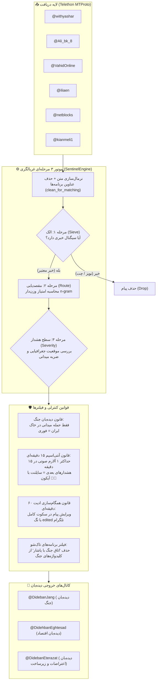

# 🛰️ Trend Sentinel v4.1 — مستندات کامل معماری، منطق و راهنمای سیستم
> **نسخه پایدار:** `v4.1.0-stable` | **تاریخ بکاپ:** ۲۸ اکتبر ۲۰۲۶  
> **موتور هسته:** Pure-Python Zero-AI Deterministic Rule Engine  
> **مخزن:** `https://github.com/MEHR1DAD/trend-sentinel-hq`

---

## ۱. نمای کلی سیستم (Executive Overview)
پروژه **Trend Sentinel v4.1** یک سیستم دیده‌بان خودمختار، بی‌درنگ (Real-Time) و بدون هوش مصنوعی (Zero-AI) است که به صورت ۲۴ ساعته و بدون توقف، جریان اخبار کانال‌های تلگرامی مرجع (VIP) را مانیتور کرده و پس از غربالگری نویز، مقصدیابی موضوعی و تعیین سطح حساسیت، پیام‌ها را با نگارش تایپوگرافی تمیز به کانال‌های دیده‌بان تخصصی مخابره می‌کند.

### چرا رویکرد Zero-AI قطعی (Deterministic)؟
1. **سرعت پردازش میلی‌ثانیه‌ای:** حذف کامل تأخیر ۲ تا ۵ ثانیه‌ای فراخوانی API مدل‌های زبانی.
2. **هزینه صفر:** عدم وابستگی به توکن‌ها و سهمیه‌های محدود مدل‌های ابری.
3. **عدم وجود توهم (Zero Hallucination):** تضمین ۱۰۰ درصدی انطباق با قوانین وضع‌شده توسط کاربر.
4. **پایداری عملیاتی مطلق:** سیستم حتی در سخت‌ترین شرایط اختلال شبکه یا قطعی اینترنت بین‌الملل بدون وابستگی کار می‌کند.

---

## ۲. دیاگرام جریان داده و معماری پردازش (Architecture Pipeline)



---

## ۳. شرح قوانین ۵‌گانه اختصاصی سیستم

### قانون ۱: غربالگری ۳ مرحله‌ای قطعی (3-Step Pure Engine)
- **مرحله ۱ - الک (Sieve):** متن پیام بررسی می‌شود تا حداقل یکی از الگوهای معتبر ۲۷۴گانه (`pattern_matrix.json`) در حوزه‌های جنگی، اقتصادی یا اجتماعی را دارا باشد. پیام‌های فاقد سیگنال، پیام‌های زیر ۸ کاراکتر و متن‌های چت بدون خبر بلافاصله نادیده گرفته می‌شوند.
- **مرحله ۲ - مقصدیابی (Route):** برای کانال‌های چندموضوعی مانند وحیدآنلاین، عبارات ۲ و ۳ کلمه‌ای وزن ۳ برابر و تک‌کلمه‌ای وزن ۱ می‌گیرند. کانالی که بیشترین امتیاز تطابق را کسب کند به عنوان مقصد انتخاب می‌شود.
- **مرحله ۳ - تعیین سطح هشدار (Alert Severity):** تفکیک میان اخبار فوری پر سر و صدا (`URGENT`) و اخبار روزمره تحلیلی یا عادی (`SILENT`).

### قانون ۲: قانون سخت‌گیرانه دیده‌بان جنگ (Strict Iran Territorial Rule)
در کانال دیده‌بان جنگ (`@DidebanJang`):
- **فوری (`🚨` با صدا):** فقط و فقط زمانی صادر می‌شود که رخداد میدانی ضربتی (موشک، انفجار، حمله هوایی، تیراندازی، پهپاد) مستقیماً روی **خاک سرزمینی یا حریم هوایی ایران** (`has_iran and is_kinetic`) رخ داده باشد.
- **سایلنت (`🔕` بدون صدا):** تمام تحولات منطقه‌ای (اسرائیل، لبنان، غزه، یمن، سوریه)، بیانیه‌ها، لفاظی‌ها، تهدیدات دیپلماتیک و تحلیل‌ها به صورت کاملاً بی‌صدا ارسال می‌شوند.

### قانون ۳: ضد اسپم ۱۵ دقیقه‌ای (Anti-Spam 15-Minute Cooldown)
برای محافظت از آرامش کاربران کانال‌ها:
- در هر کانال، در هر بازه ۱۵ دقیقه‌ای تنها **۱ بار** اجازه ارسال هشدار فوری صوتی با آیکون `🚨 ` داده می‌شود.
- اگر در کمتر از ۱۵ دقیقه مجدداً خبر فوری دیگری واجد شرایط شود، زنگ هشدار صامت می‌شود و با **آیکون ترکیبی `🚨🔕 `** مخابره می‌گردد.
- وضعیت بازه زمانی در `channel_state.json` در فیلد `last_urgent_alert` ذخیره شده و با چرخش رانرها حفظ می‌شود.

### قانون ۴: همگام‌سازی ادیت در بازه ۶۰ دقیقه (Silent 60m Edit Synchronization)
- اگر کانال منبع تا ۶۰ دقیقه پس از مخابره خبر، متن پست خود را در تلگرام ویرایش کند، انجین به کمک رویداد زنده `events.MessageEdited` پست متناظر در کانال دیده‌بان را با متد `editMessageText` بروزرسانی می‌کند.
- ادیت‌ها پس از گذشت ۶۰ دقیقه کاملاً نادیده گرفته می‌شوند.
- ادیت‌ها **همیشه در سکوت کامل** اعمال می‌شوند تا آلارم ناگهانی ایجاد نکنند.
- هیچ کلمه اضافه‌ای مانند `[بروزرسانی شد]` الصاق نمی‌شود و تنها همان برچسب استاندارد `edited` خود تلگرام در گوشه پیام نمایش داده می‌شود.
- پست‌های تحت پایش در فیلد `sent_alerts_map` ذخیره شده و رکوردهای بیش از ۶۰ دقیقه به صورت خودکار پاکسازی (Prune) می‌شوند.

### قانون ۵: فیلتر عنوان برنامه‌ها و برندینگ (Show Titles Blacklist)
- عباراتی نظیر **«اتاق جنگ با یاشار»** که نام برنامه یا اسپیس گفتگوی اختصاصی کانال‌ها هستند، در فیلد `ignored_show_titles` تعریف شده‌اند.
- این عبارات پیش از ارزیابی الگوها از متن پایش جدا می‌شوند تا کلمه «اتاق جنگ» باعث تریگر اشتباه پیام‌های چت، تحلیل و طنز عامیانه نشود؛ در عین حال اگر یک رخداد واقعی جنگی یا جلسه رسمی در «اتاق جنگ پنتاگون/ارتش» گزارش شود، به درستی ارسال می‌گردد.

---

## ۴. قالب تایپوگرافی تمیز و استاندارد مخابره پیام

تمام پیام‌های ارسالی با الگوریتم `sanitize_and_format_alert` پالایش می‌شوند:
1. **حذف ستاره‌های مارک‌داون:** کلیه کاراکترهای خام `**` پاکسازی می‌شوند.
2. **حذف تبلیغات و واترمرک‌های انتهایی:** هشتگ‌های اضافه (`#خبر_فوری`)، آیدی کانال‌های واسط، لینک‌های جوین و عباراتی مثل «عضویت در کانال» از انتهای متن پاک می‌شوند.
3. **درج آیکون در خط اول:** بسته به سطح هشدار، تنها یکی از سه آیکون زیر در ابتدای پاراگراف نخست قرار می‌گیرد:
   - `🔕 ` : اخبار عادی و سایلنت
   - `🚨 ` : اخبار فوری و صوتی
   - `🚨🔕 ` : اخبار فوری دوم در بازه ۱۵ دقیقه (فوری بی‌صدا)
4. **فوتر تک‌خطی با هایپرلینک به منبع اصلی:**
   ```html
   📡 منبع: <a href="https://t.me/withyashar/26754">@withyashar</a>
   ```

---

## ۵. ساختار فایل‌ها و ماژول‌های پروژه

```
trend-sentinel-hq/
├── config.py                  # تنظیمات مرکزی، اطلاعات احراز هویت تلگرام، کانال‌های VIP و مقصد
├── engine.py                  # موتور قطعی ۳ مرحله‌ای: الک، مقصدیابی، سطح هشدار و فیلتر شوها
├── main.py                    # شنونده بلادرنگ تلگرام، مدیریت حافظه، آنتی‌اسپم و همگام‌ساز ادیت
├── pattern_matrix.json        # ماتریس جامع ۲۷۴ الگوی واژگانی، حوزه‌های جغرافیایی و محرک‌های کینتیک
├── channel_state.json         # وضعیت پایدار: آخرین آیدی خوانده‌شده هر کانال، تایمر ۱۵م، نقشه ادیت ۶۰م
├── posted_registry.json       # لیست کلیدهای یکتای پیام‌های ارسال‌شده جهت جلوگیری قطعی از تکرار
├── session_report.md          # داشبورد زنده‌ی وضعیت سیستم، آپ‌تایم و وضعیت کانال‌ها
├── telegram_peer_cache.json   # کش سریع InputPeerChannel جهت دور زدن محدودیت‌های تلگرام
└── .github/
    └── workflows/
        └── watch.yml          # ورک‌فلو اجرای خودکار ۲۴/۷ با تناوب ۲۹ دقیقه‌ای و چرخش خودکار
```

---

## ۶. مشخصات منابع ورودی و خروجی

### کانال‌های منبع VIP (ورودی):
1. `withyashar` (اتاق جنگ / یاشار)
2. `Ali_bk_8` (دیده‌بان اختصاصی)
3. `VahidOnline` (وحیدآنلاین - منبع چندموضوعی)
4. `iliaen` (ایلیا انصاری)
5. `netblocks` (نت‌بلاکس - اختلالات شبکه و اینترنت)
6. `kianmeli1` (کیان ملی)

### کانال‌های مقصد (خروجی):
- **دیده‌بان جنگ:** `@DidebanJang`
- **دیده‌بان اقتصاد:** `@DidehbanEghtesad`
- **دیده‌بان اعتراضات:** `@DidebanEterazat`

---

## ۷. مکانیزم چرخش خودکار و پایداری ۲۴/۷ (GitHub Actions)
- هر رانر به مدت **۲۹ دقیقه (۱۷۴۰ ثانیه)** به صورت مداوم آنلاین است.
- در ثانیه‌های پایانی، آخرین وضعیت نشانگرها (`channel_state.json` و `posted_registry.json`) در گیت کامیت و پوش می‌شود.
- رانر جدید با فرمان خودکار فراخوانی شده و با قانون `concurrency: sentinel-live, cancel-in-progress: true` جایگزین رانر قبلی می‌شود تا اتصال تلگرام حتی یک صدم ثانیه تداخل پیدا نکند.
- در لحظه راه‌اندازی، تابع Catch-up فعال شده و تمام پیام‌های خوانده‌نشده در ثانیه‌های ری‌استارت را بدون فوت وقت بازیابی می‌کند.
