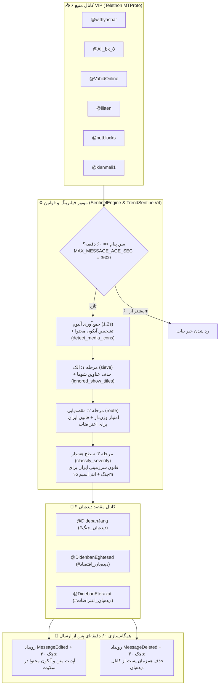

# 🛰️ Trend Sentinel v4.6.0-stable — مستندات نسخه پایدار و راهنمای بکاپ / بازگشت

> **نسخه پایدار (Stable):** `v4.6.0` | **تگ گیت:** `v4.6.0-stable` | **شاخه بکاپ:** `backup/v4.6.0-stable`  
> **کد پایه تاییدشده:** `833b9143` | **وضعیت عملیاتی (Live Check):** فعال و پایدار روی GitHub Actions (`Run #7442`، `2026-11-12`)  
> **مخزن:** `https://github.com/MEHR1DAD/trend-sentinel-hq`

---

## ۱. نمای کلی نسخه و چرایی انتخاب به عنوان نسخه Stable

نسخه **Trend Sentinel v4.6.0** حاصل تکامل و پایدارسازی کامل موتور بلادرنگ Zero-AI بر پایه نسخه‌های `v4.1` تا `v4.6` است و تمام باگ‌های عملیاتی گذشته (ارسال اخبار بیات، واترمرک کانال‌های واسط، حذف/ویرایش ناهماهنگ، تداخل رانرها و نبود آیکون نوع محتوا) در آن برطرف شده است.

### ویژگی‌های کلیدی معماری فعلی (`v4.6.0`):
1. **موتور قطعی Zero-AI (Pure Python):** پردازش میلی‌ثانیه‌ای در ۳ مرحله (`sieve` ← `route` ← `classify_severity`) بدون وابستگی به API مدل‌های زبانی و با استفاده از ماتریس واژگانی `pattern_matrix.json`.
2. **پوشش ۲۴/۷ بدون تداخل رانرها (Zero-Race Architecture):** اجرای ۲۶ دقیقه‌ای (`MAX_RUNTIME_SEC = 1560`) با پیش‌همگام‌سازی گیت (`git pull origin main`)، ذخیره قطعی وضعیت (`if: always()`), دست‌به‌دست شدن خودکار و دیده‌بان هوشمند ۱۰ دقیقه‌ای (`watchdog.yml`) از طریق GitHub REST API + کران ۳ ساعته احتیاطی.
3. **پایش کامل چرخه عمر خبر در بازه ۶۰ دقیقه (`EDIT_DELETE_WINDOW_SEC = 3600`):**
   - **محافظت در برابر اخبار بیات (`MAX_MESSAGE_AGE_SEC = 3600`):** پیام‌های قدیمی‌تر از ۶۰ دقیقه هرگز به کانال‌ها ارسال نمی‌شوند.
   - **همگام‌سازی ویرایش ۶۰ دقیقه‌ای (`handle_edited_message`):** آپدیت بی‌صدا و بدون برچسب اضافی هنگام ویرایش پست منبع.
   - **همگام‌سازی حذف ۶۰ دقیقه‌ای (`handle_deleted_message` + `sync_active_tracked_alerts`):** حذف همزمان پست در کانال‌های دیده‌بان هم از طریق رویداد زنده `MessageDeleted` و هم از طریق چک دوره‌ای ۳۰ ثانیه‌ای (`SYNC_INTERVAL_SEC = 30.0`).
4. **آیکون پویا بر اساس نوع محتوای منبع (`detect_media_icons`) و پشتیبانی آلبوم:**
   - نمایش خودکار آیکون متعلقات پست در کنار نام منبع (`📷` عکس، `🎥` ویدیو/گیف، `🔊` صدا/ویس، `📎` فایل/سند، `📊` نظرسنجی، `📍` لوکیشن، `👤` مخاطب و `📝` برای پست‌های صرفاً متنی).
   - جمع‌آوری پیام‌های چندرسانه‌ای آلبوم (`ALBUM_DEBOUNCE_SEC = 1.2`) و بروزرسانی خودکار آیکون هنگام آپدیت متعلقات یا پیوست‌های آلبوم در ۶۰ دقیقه آینده (`_sync_grouped_media_if_dispatched`).
5. **پاکسازی پیشرفته واترمرک و تبلیغات (`sanitize_and_format_alert`):** حذف لینک‌ها، هشتگ‌های تبلیغاتی انتهایی، واترمرک‌های `@WarRoom` / `@War_Room` / `@withyashar` و آیدی‌های زنجیره‌ای `@VahidOnline` / `@VahidHeadline` / `@VahidOOnLine`.

---

## ۲. دیاگرام جریان پردازش (`v4.6.0 Pipeline`)



---

## ۳. تاریخچه تغییرات پایدار از `v4.1.0-stable` تا `v4.6.0-stable`

| نسخه / تگ | کامیت | خلاصه تغییر |
| :--- | :--- | :--- |
| `v4.2.0-stable` | `912efb75` | معماری Zero-Race، پیش‌همگام‌سازی گیت در استارتاپ، کاهش تایم رانر به ۲۶ دقیقه (`1560s`)، ذخیره وضعیت `if: always()`، حذف واترمرک `@VahidOnline` و اعمال قانون جغرافیایی ایران برای `@DidebanEterazat` |
| `v4.3.0-stable` | `5fd2d180` | افزودن دیده‌بان غیرمزاحم ۱۰ دقیقه‌ای (`watchdog.yml`) و چرخه اجرای پیوسته تمیز |
| `v4.3.1-stable` | `aa945d8d` | پاکسازی کامل مخزن و حذف ورک‌فلوهای قدیمی و خطادار (`train.yml`, `daily_briefing.yml`, `join.yml`, `mine_protests.yml`, `extract_economy.yml`) |
| `v4.4.0-stable` | `7a5c571e` | اعمال فیلتر قطعی ۶۰ دقیقه (`MAX_MESSAGE_AGE_SEC`) برای جلوگیری از اخبار بیات، ارتقای `watchdog.yml` به GitHub REST API خالص + کران احتیاطی ۳ ساعته در `watch.yml` |
| `v4.4.1-stable` | `79b7c323` | حذف واترمرک‌های انتهایی و میانی `@WarRoom` / `@War_Room` و `@withyashar` در خروجی پیام‌ها |
| `v4.5.0-stable` | `c0eff0b1` | همگام‌سازی حذف ۶۰ دقیقه‌ای (`events.MessageDeleted` + `delete_bot_alert` + چک دوره‌ای ۳۰ ثانیه‌ای `sync_active_tracked_alerts`) |
| **`v4.6.0-stable`** | **`833b9143`** | **آیکون پویای محتوای منبع (`📷 🎥 🔊 📎 📊 📍 👤` و `📝`)، تشخیص چندرسانه‌ای آلبوم و همگام‌سازی آپدیت متعلقات در ۶۰ دقیقه** |

---

## ۴. نگاشت آیکون‌های نوع محتوا و قالب خروجی (`v4.6.0`)

متد `detect_media_icons` در `main.py` بر اساس ترتیب استاندارد `ICON_ORDER = ("📷", "🎥", "🔊", "📎", "📊", "📍", "👤")` متعلقات پست (یا آلبوم) را بررسی می‌کند:

- `📷` : عکس (`MessageMediaPhoto`)
- `🎥` : ویدیو یا انیمیشن/گیف (`DocumentAttributeVideo` / `DocumentAttributeAnimated` / `video/*`)
- `🔊` : فایل صوتی یا پیام صوتی (`DocumentAttributeAudio` / `audio/*`)
- `📎` : سایر فایل‌ها و اسناد غیر از استیکر (`MessageMediaDocument`)
- `📊` : نظرسنجی (`MessageMediaPoll`)
- `📍` : موقعیت مکانی (`MessageMediaGeo` / `MessageMediaGeoLive` / `MessageMediaVenue`)
- `👤` : کارت مخاطب (`MessageMediaContact`)
- `📝` (`TEXT_ICON`) : **فقط** زمانی که پست صرفاً متنی باشد (یا فقط WebPage Preview داشته باشد)؛ در صورت وجود هرگونه پیوست رسانه‌ای، آیکون `📝` حذف و فقط آیکون(های) رسانه درج می‌شوند.

**قالب فوتر نهایی پیام در دیده‌بان:**
```html
📷🎥 منبع: <a href="https://t.me/withyashar/27859">@withyashar</a>
```

---

## ۵. ساختار فایل‌ها و تنظیمات هسته

```text
trend-sentinel-hq/
├── VERSION                      # 4.6.0
├── config.py                    # تنظیمات منابع، کانال‌ها، تایمرها (26m / 60m / 30s / 1.2s)
├── engine.py                    # موتور ۳ مرحله‌ای SentinelEngine
├── main.py                      # کلاینت Telethon، آیکون رسانه، همگام‌سازی ویرایش/حذف و گزارش سشن
├── pattern_matrix.json          # ماتریس الگوها (89 جنگ، 56 اقتصاد، 50 اعتراضات، 50 ایران، 42 منطقه، 29 کینتیک، 2 فیلتر شو)
├── RELEASE_v4.1.md              # مستندات نسخه پایه 4.1
├── RELEASE_v4.6.md              # همین سند (بکاپ پایدار 4.6.0 و راهنمای بازگشت)
├── channel_state.json           # نشانگر آخرین پیام هر کانال، کول‌داون ۱۵ دقیقه و واچرهای ۶۰ دقیقه‌ای
├── posted_registry.json         # رجیستری جلوگیری از تکرار پست‌ها
├── session_report.md            # گزارش زنده سشن جاری
└── .github/workflows/
    ├── watch.yml                # اجرای زنده ۲۶ دقیقه‌ای، ذخیره وضعیت و ری‌استارت خودکار
    └── watchdog.yml             # دیده‌بان ۱۰ دقیقه‌ای بدون تداخل با اکشن‌های فعال
```

---

## ۶. راهنمای کامل بازگشت به نسخه پایدار (`Rollback Guide`)

اگر تغییرات آینده روی شاخه `main` باعث اختلال در ربات یا منطق فیلترینگ شد، با یکی از دو روش زیر می‌توانید سیستم را فوراً به نسخه پایدار **`v4.6.0-stable`** برگردانید:

### روش اول: بازگردانی شاخه `main` از روی شاخه بکاپ `backup/v4.6.0-stable` (توصیه‌شده)
این روش علاوه بر کدهای اصلی `v4.6.0`، ساختار بکاپ تاییدشده را به صورت امن به نوک شاخه `main` بازمی‌گرداند:

```bash
git checkout main
git pull origin main
git checkout backup/v4.6.0-stable -- config.py engine.py main.py pattern_matrix.json VERSION .github/workflows/ RELEASE_v4.6.md
git commit -m "revert: rollback engine to v4.6.0-stable backup"
git push origin main
```

> **مزیت روش اول:** فایل‌های وضعیت لحظه‌ای تلگرام (`channel_state.json` و `posted_registry.json`) دست‌نخورده باقی می‌مانند تا اخبار ارسال‌شده مجدداً تکرار نشوند.

### روش دوم: بازگشت کامل (Hard Reset) به نقطه بکاپ یا تگ `v4.6.0-stable`
اگر می‌خواهید کل کد و تنظیمات دقیقاً به نقطه بکاپ یا تگ `v4.6.0-stable` بازگردانده شود (توجه: اگر فایل‌های state قدیمی باشند، به دلیل `MAX_MESSAGE_AGE_SEC = 3600` باز هم اخبار بیش از ۶۰ دقیقه ارسال نخواهند شد):

```bash
# بازگشت با استفاده از شاخه بکاپ:
git checkout main
git reset --hard origin/backup/v4.6.0-stable
git push --force-with-lease origin main

# یا بازگشت مستقیم با استفاده از تگ انتشار v4.6.0-stable:
git checkout main
git reset --hard v4.6.0-stable
git push --force-with-lease origin main
```

### فعال‌سازی فوری پس از بازگشت:
پس از `git push` روی `main`، ورک‌فلو `Sentinel Watch (v4 Pure Engine)` به صورت خودکار ظرف چند ثانیه راه‌اندازی و جایگزین رانر قبلی می‌شود. در صورت نیاز به اجرای دستی نیز از **GitHub Actions ← Sentinel Watch (v4 Pure Engine) ← Run workflow** استفاده کنید.
