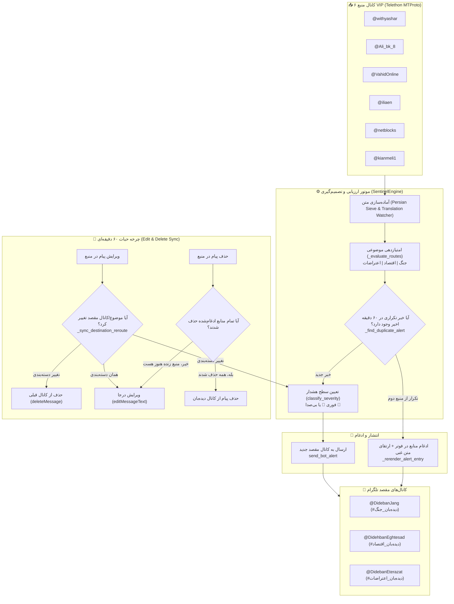

# 🛰️ Trend Sentinel v6.3.0-stable — مستندات نسخه پایدار و راهنمای بکاپ / بازگشت

> **نسخه پایدار (Stable):** `v6.3.0` | **تگ گیت:** `v6.3.0-stable` | **شاخه بکاپ:** `backup/v6.3.0-stable`  
> **کد پایه تاییدشده:** `152ab477` | **وضعیت عملیاتی (Live Check):** فعال و پایدار روی GitHub Actions (آبان ۱۴۰۵ / نوامبر ۲۰۲۶)  
> **مخزن:** `https://github.com/MEHR1DAD/trend-sentinel-hq`

---

## ۱. نمای کلی نسخه و چرایی انتخاب به عنوان نسخه پایدار (Stable Milestone)

نسخه **Trend Sentinel v6.3.0** نقطه اوج تکامل سیستم پس از مهاجرت‌های بزرگ معماری از نسل‌های v4 و v5 است. این نسخه تمامی قابلیت‌های پردازش بلادرنگ بدون مدل زبانی (Zero-AI Deterministic Engine)، مانیتورینگ چندمنبعی، و حفاظت از کیفیت محتوای کانال‌های دیده‌بان را در یک ساختار کاملاً یکپارچه و ضد تداخل (Zero-Race) گرد هم آورده است.

### ارکان کلیدی معماری نسخه `v6.3.0`:

1. **مسیریابی مجدد پویا بر اثر ادیت بعدی منبع (Dynamic Cross-Channel Topical Re-routing):**
   - چنانچه کانال منبع در بازه ۶۰ دقیقه متن خبر را ویرایش کند و این ویرایش ماهیت رخداد را تغییر دهد (مثلاً خبر اولیه از رویداد اقتصادی/نفتکش به رویداد جنگی/حمله موشکی در تنگه هرمز تبدیل شود)، متد `_sync_destination_reroute` به صورت خودکار پیام قبلی را از کانال مبدأ حذف (`deleteMessage`) و به کانال مقصد جدید ارسال یا با خبر مشابه موجود در مقصد ادغام می‌کند.
2. **موتور ضدتکرار چندمنبعی هوشمند (Cross-Source Rich Deduplication):**
   - جلوگیری کامل از ارسال اخبار تکراری هنگامی که چند کانال VIP مستقل (یاشار، وحید آنلاین، علی، ایلیا و...) یک خبر واحد را منتشر می‌کنند.
   - اعمال رفتار **ارتقای متن غنی (Rich Upgrade)**: متن پیام اول در صورت مفصل‌تر بودن متن دوم ارتقا می‌یابد و تمامی منابع به همراه آیکون رسانه‌ای اختصاصی خود در فوتر زیر هم درج می‌شوند.
   - **محافظت در برابر حذف جزئی (Partial Deletion Safety):** اگر یکی از منابع ادغام‌شده پست خود را حذف کند، پیام از کانال‌های دیده‌بان حذف نمی‌شود؛ تنها لینک آن منبع از فوتر کنار گذاشته شده و پیام با منبع زنده باقی می‌ماند.
3. **پشتیبانی دوگانه از منابع چندزبانه و رصد ترجمه فارسی (Source-Aware Extraction):**
   - منابع دوزبانه (نظیر `@Ali_bk_8` با الگوی انگلیسی-اول و ادیت فارسی با تاخیر) در لیست انتظار (`pending_translations`) نگهداری شده و بلافاصله پس از ادیت فارسی ظرف بازه ۶۰ دقیقه‌ای منتشر می‌شوند.
   - پشتیبانی اختصاصی از گراف‌های قطعی اینترنت نت‌بلاکس (`@netblocks`) و بازنشر همزمان دوکاناله (دیده‌بان اعتراضات + دیده‌بان جنگ).
4. **بانک جامع اسامی جغرافیایی و نقاط حساس ایران:**
   - پوشش دقیق تمام شهرها، شهرستان‌ها، دهستان‌ها، بنادر، جزایر، کوه‌ها و نقاط حساس ساحلی جنوب (سیریک، جاسک، کوهستک، لنگه، عسلویه، خارگ و...).
5. **فوتر اختصاصی عمودی با لینک‌های تمیز مارک‌داون:**
   - نمایش استاندارد منابع به فرم عمودی با آیکون نوع رسانه (`🎥 [@iliaen](https://t.me/iliaen/4754)`).

---

## ۲. دیاگرام جریان داده و لوله‌کشی پردازش (`v6.3.0 Pipeline`)



---

## ۳. ساختار داده‌ها و مدل ماندگاری وضعیت (`channel_state.json`)

در نسخه v6.3.0 هر رکورد درون `sent_alerts_map` به جای فیلدهای تک‌مقداری قدیمی، ساختار چندمنبعی (`sources`) و چندکاناله (`dispatches`) دارد:

```json
{
  "channels": {
    "withyashar": {"last_read_id": 28067, "last_read_time": "2026-11-14 16:34:57 UTC"},
    "Ali_bk_8": {"last_read_id": 8304, "last_read_time": "2026-11-14 16:47:38 UTC"},
    "VahidOnline": {"last_read_id": 79113, "last_read_time": "2026-11-14 14:16:43 UTC"}
  },
  "last_urgent_alert": {
    "@DidebanJang": 1794680000.0,
    "@DidehbanEghtesad": 1794500000.0,
    "@DidebanEterazat": 1794100000.0
  },
  "sent_alerts_map": {
    "withyashar_27985": {
      "sources": [
        {"source_node": "withyashar", "msg_id": 27985, "media_icons": "📝"},
        {"source_node": "VahidOnline", "msg_id": 79050, "media_icons": "📷"}
      ],
      "dispatches": [
        {"target_channel": "@DidebanJang", "bot_msg_id": 926, "status_icon": "🔕"}
      ],
      "active_text_source": "VahidOnline_79050",
      "sent_timestamp": 1794660000.0
    }
  },
  "pending_translations": {}
}
```

---

## ۴. فایل‌ها و اجزای تشکیل‌دهنده هسته

| فایل | نقش و وظیفه |
| :--- | :--- |
| `main.py` | حلقه اصلی Telethon، هماهنگی صف رویدادها، لایف‌سایکل ۶۰m ادیت/حذف، متد `_sync_destination_reroute` و ارتباط با Bot API |
| `engine.py` | موتور قطعی ۳ مرحله‌ای، محاسبه اثرانگشت رویداد (`build_event_fingerprint`)، مقایسه تکراری‌ها (`is_duplicate_event`) و قوانین ارتقای متن |
| `config.py` | تنظیمات مرکزی، آیدی کانال‌ها، توکن‌های دسترسی، آستانه‌های زمانی (`EDIT_DELETE_WINDOW_SEC = 3600`) |
| `pattern_matrix.json` | ماتریکس الگوهای واژگانی، نقاط جغرافیایی ایران، کلیدواژه‌های اورژانسی، عبارات ضدتکرار و تکذیبیه‌ها |
| `.github/workflows/sentinel.yml` | پایپ‌لاین اجرای خودکار ۲۶ دقیقه‌ای با استراتژی Zero-Race بر بستر رانرهای GitHub Actions |
| `.github/workflows/watchdog.yml` | دیده‌بان هوشمند ۱۰ دقیقه‌ای جهت تضمین پایداری دائمی و راه‌اندازی رانر در صورت وقفه |

---

## ۵. راهنمای بازگشت به این نسخه (Rollback Guide)

در صورتی که در نسخه‌های آینده مشکلی رخ دهد و نیاز به بازگشت فوری به این نقطه پایدار باشد:

### بازگردانی سریع شاخه main به این بکاپ:
```bash
git fetch origin
git checkout main
git reset --hard origin/backup/v6.3.0-stable
git push origin main --force
```

### بررسی اجرا روی رانر گیت‌هاب:
پس از فورس پوش، اکشن `Sentinel Watch (v4 Pure Engine)` روی آخرین کد این نسخه پایدار به طور خودکار اجرا خواهد شد.
