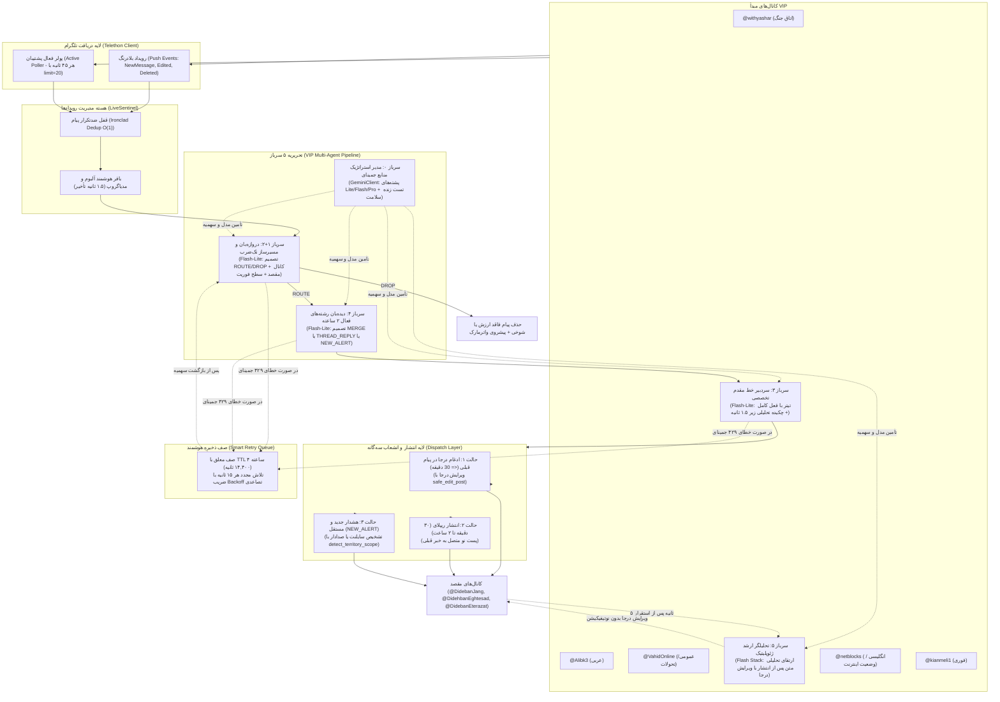

# مستندات جامع معماری و ساختار پروژه دیده‌بان (Sentinel HQ v2.5 Architecture Baseline)
**تاریخ ایجاد بک‌آپ و مستندسازی:** جمعه، ۱ آبان ۱۴۰۵ (2026-10-23)  
**برنچ پشتیبان:** `archive/baseline-v2.5-gemini-multi-agent`  
**تگ رسمی گیت:** `backup/v2.5-multi-agent-baseline-2026-10-23`  
**آخرین کامیت مرجع:** `961321ac` / `be776a0e`

---

## ۱. نمای کلی سیستم و مأموریت سامانه (Executive Overview)

پروژه **Sentinel HQ (دیده‌بان)** یک سامانه پایش و تحریریه هوشمند زنده ۲۴/۷ است که بر بستر تلگرام و GitHub Actions مستقر است. این سامانه با استفاده از معماری چندعامله (Multi-Agent Editorial Pipeline) و مدل‌های خانواده Google Gemini، پیام‌های کانال‌های خبری کلیدی را رصد کرده، شوخی‌ها و تبلیغات را غربال نموده، رویدادهای میدانی و اقتصادی را بازنویسی ژورنالیستی می‌کند و با فرمت استاندارد، به ۳ کانال تخصصی ارسال می‌نماید:

1. **`@DidebanJang` (دیده‌بان جنگ):** اخبار نظامی، تحرکات موشکی/پهپادی، حملات هوایی، انفجارها، درگیری‌های منطقه‌ای و زلزله‌های داخل ایران.
2. **`@DidehbanEghtesad` (دیده‌بان اقتصاد):** نوسانات لحظه‌ای دلار، تتر، طلا، سکه، نفت، انرژی، تحریم‌ها و شاخص‌های کلان اقتصادی.
3. **`@DidebanEterazat` (دیده‌بان اعتراضات):** گزارش‌های کارگری، احکام قضایی، دادگاه، زندان، اعدام، حقوق بشر و مطالبات صنفی.

---

## ۲. دیاگرام جریان داده و معماری چندعامله (Architecture & Data Flow)



---

## ۳. ساختار درختی فایل‌ها و ماژول‌های پروژه

```
trend-sentinel-hq/
├── .github/
│   └── workflows/
│       ├── watch.yml                  # ورک‌فلو اصلی اجرای زنده در GitHub Actions (چرخه ۲۸ دقیقه‌ای)
│       ├── daily_briefing.yml         # خلاصه شبانه (ساعت ۰۰:۰۰)
│       └── extract_economy.yml        # ماینینگ الگوهای اقتصادی
├── backend/
│   ├── core/                          # هسته زیرساخت مشترک
│   │   ├── __init__.py
│   │   ├── config.py                  # تنظیمات سراسری، کلیدها، کلمات کلیدی، تقویم جلالی، سیاست صوت
│   │   ├── db.py                      # مدیریت پایگاه داده SQLite با ژورنال WAL و اتصال ۳۰ ثانیه‌ای
│   │   ├── gemini.py                  # سرباز صفر: ماتریس ۲ بعدی مدل×کلید، پشته‌ها و استعلام ۱۲ ساعته
│   │   └── thread_manager.py          # مدیریت انطباق رویدادها، لنگرگاه‌ها (Anchors) و دیبانس
│   ├── pipelines/                     # خطوط تحریریه و پردازش
│   │   ├── __init__.py
│   │   ├── vip_multi_agent.py         # پایپ‌لاین یکپارچه ۵ سرباز برای تمام کانال‌های VIP
│   │   ├── yashar.py                  # (کد موروثی و بایگانی‌شده - جایگزین شده با vip_multi_agent)
│   │   └── mirror.py                  # (کد موروثی و بایگانی‌شده - جایگزین شده با vip_multi_agent)
│   ├── live_sentinel.py               # ارکستراتور اصلی (Master Orchestrator)، حلقه رویداد و پولر فعال
│   ├── daily_report.py                # ارسال پیام وضعیت شبانه در صورت آرامش کانال‌ها
│   ├── sentinel_config.json           # لیست کانال‌های تحت پایش (nodes) و الگوهای کلمات
│   ├── sentinel_state.json            # فایل پایدار وضعیت (صف هوشمند، واتر‌مارک‌ها، رشته‌های فعال)
│   ├── posted_registry.db             # دیتابیس پایدار SQLite برای جلوگیری قطعی از دابل‌پست
│   ├── telegram_peer_cache.json       # کش دائمی شناسه‌های عددی (Access Hash) کانال‌های تلگرام
│   ├── model_cache.json               # کش پشته‌های پویای جمینای
│   └── subscribers.json               # مشترکین دستور /start در ربات تلگرام
├── session_report.md                  # گزارش آخرین وضعیت اجرای رانر
└── README.md
```

---

## ۴. شرح وظایف سربازان ۵‌گانه در تحریریه هوشمند

| شناسه سرباز | نام و جایگاه ژورنالیستی | مدل هوش مصنوعی | زمان پاسخ | وظیفه اصلی |
| :--- | :--- | :--- | :--- | :--- |
| **سرباز ۰** | مدیر استراتژیک مدل‌ها و سهمیه‌ها | کد زیرساخت (`GeminiClient`) | فوری | استعلام ۱۲ ساعته از گوگل، تست سلامت زنده ۱ توکنی، حذف مدل‌های دپریکیت‌شده، ماتریس دو بعدی (مدل × کلید) و ایزولاسیون خطای ۴۲۹ |
| **سرباز ۱+۲** | دروازه‌بان و مسیرساز فوق‌سریع | `gemini-3.5-flash-lite` | کمتر از ۱ ثانیه | غربال شوخی‌ها/تبلیغات (DROP/ROUTE)، تعیین کانال مقصد (`@DidebanJang` یا اقتصاد یا اعتراضات)، سطح فوریت (`EMERGENCY`, `BREAKING`, `REGIONAL`) و ارتباط با ایران |
| **سرباز ۴** | دیده‌بان رشته‌های فعال ۲ ساعته | `gemini-3.5-flash-lite` | کمتر از ۱ ثانیه | بررسی انطباق رویداد جدید با هشدارهای باز قبلی بر مبنای حوزه جغرافیایی (Scope)؛ اتخاذ تصمیم `MERGE` (زیر ۳۰ دقیقه)، `THREAD_REPLY` (۳۰ دقیقه تا ۲ ساعت) یا `NEW_ALERT` |
| **سرباز ۳** | سردبیر تخصصی خط مقدم | `gemini-3.5-flash-lite` | کمتر از ۱.۵ ثانیه | ترجمه تسلیحاتی عربی/انگلیسی به فارسی روان، ساخت تیتر مقتدر با «فعل کامل»، نگارش چکیده تحلیلی و آماده‌سازی برای ارسال فوری تلگرام |
| **سرباز ۵** | تحلیلگر ارشد ژئوپلیتیک | `gemini-3.5-flash` (پشته فلش) | پس‌زمینه (۵ تا ۱۰ ثانیه) | پس از انتشار اولیه زیر ۳ ثانیه‌ای، به صورت Background فعال شده و متن تلگرام را با قلم فاخر، مستند و تحلیلی درجا ویرایش (`safe_edit_post`) می‌کند |

---

## ۵. سیاست صوتی و هشدارهای سایلنت (Sound Notification Policy)

سیستم دیده‌بان مجهز به یک طبقه‌بندی هوشمند دو مرحله‌ای در [`backend/core/config.py`](file:///Users/mehrdad/Documents/GitHub/trend-sentinel-hq/backend/core/config.py) است:

```python
# الف) اخبار خارج از مرزهای ایران (FOREIGN):
# صرف‌نظر از تلفات یا شدت درگیری، همیشه بدون استثنا سایلنت هستند:
is_silent = True  # (🔕 هشدار منطقه‌ای)

# ب) اخبار داخل خاک و شهرهای ایران (IRAN):
# منحصراً در صورت حملات کینتیک، انفجار، آژیر قرمز، موشک یا زلزله شدید:
is_silent = False # (🚨 هشدار فوری با صدای بلند)
# استثنا: تنگه هرمز و خلیج فارس به دلیل ماهیت مداوم گشت‌ها سایلنت است.
```

---

## ۶. چترهای نجات، پایداری و امنیت داده‌ها (Resilience & Parachutes)

1. **صف هوشمند ۴ ساعته (`smart_queue`):** در صورت بروز قطعی اینترنت، اختلال موقت گوگل یا خطای ۴۲۹ سهمیه، هیچ پیامی حذف یا سوزانده نمی‌شود؛ پیام‌ها در `sentinel_state.json` ذخیره و هر ۱۵ ثانیه با تأخیر تصاعدی بازتلاش می‌شوند.
2. **پشتیبانی از فرمت متن خام تلگرام (Plain-Text Fallback):** در صورتی که خروجی هوش مصنوعی حاوی کاراکتر ناقص مارک‌داون باشد که باعث رد پیام توسط تلگرام شود، سیستم بلافاصله با متن خام (`parse_mode=None`) پیام را بدون خطا ارسال یا ادیت می‌کند.
3. **قفل آهنین دابل‌پست (Ironclad Dedup):** کنترل ۳ لایه‌ای (حافظه RAM + پایگاه داده SQLite + چتر نجات حذف پیام‌های همسان پس از ارسال).
4. **کش دائمی شناسه‌های تلگرام (`telegram_peer_cache.json`):** ذخیره دائمی `access_hash` و `channel_id` تمام کانال‌ها روی دیسک؛ صفر درخواست `ResolveUsername` به تلگرام و پیشگیری کامل از خطای `FloodWaitError`.
5. **اتصال ایمن SQLite:** تنظیم ژورنال WAL با `timeout=30.0` روی تمام اتصالات برای عدم تداخل خواندن/نوشتن چندنخی.

---

## ۷. نحوه بازیابی به این نسخه در آینده (Rollback Instructions)

اگر در آینده بخواهید سیستم را دقیقاً به همین لحظه و همین ساختار پایدار بازگردانید، کافی است دستورات زیر را در ترمینال اجرا کنید:

```bash
# ۱. دریافت آخرین تغییرات و برنچ‌های گیت
git fetch --all --tags

# ۲. بازگشت کامل به تگ بک‌آپ نسخه ۲.۵
git checkout backup/v2.5-multi-agent-baseline-2026-10-23

# یا سوئیچ به برنچ دائمی آرشیو
git checkout archive/baseline-v2.5-gemini-multi-agent
```
